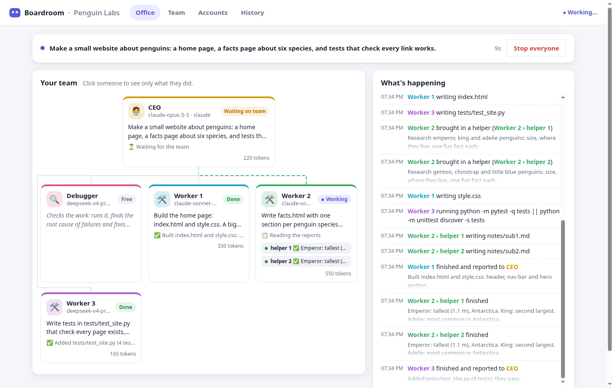

# Boardroom

**Turn the AI accounts you already have into a company of AI agents.**

Connect your Claude subscription, your ChatGPT subscription, a DeepSeek key, a local Ollama, or
anything else. Boardroom sorts the models into a team:

```
My AI Company  ·  autonomy: full
CEO           opus · claude              subagents: haiku
├─ debugger   gpt-6.1-sol · chatgpt      subagents: gpt-6-luna
├─ worker-1   sonnet · claude            subagents: haiku
├─ worker-2   sonnet · claude            subagents: haiku
├─ worker-3   sonnet · claude            subagents: haiku
└─ worker-4   sonnet · claude            subagents: haiku
```

- The **CEO** is your strongest model. It plans the work, does the hardest parts itself and hands
  out the rest.
- The **debugger** checks the work, so it is a strong model from a *different* AI company:
  fresh eyes catch different mistakes.
- **Workers** are good-value models doing the bulk of the work, in parallel.
- Anyone can start **subagents** (usually a fast, cheap model) for parts of a task that can run
  at the same time.

Then you give the company a goal and watch it work, in your browser (`boardroom ui`):



<sub>A scripted demo run. Dark mode: [docs/office-dark.png](docs/office-dark.png).</sub>

…or in the terminal (`boardroom run`):

```
$ boardroom run "make a small website about penguins, with tests"

15:54:04  CEO                     started · opus · claude
15:54:40  CEO → worker-1          "Build the page layout in site/index.html and site/style.css…"
15:54:40  CEO → worker-2          "Write the penguin facts page in site/facts.html…"
15:54:41  worker-1                ⚙ Write site/index.html
15:54:55  worker-2 ↳ sub1         new: "Find and write 10 penguin species facts…"
15:57:12  worker-1 → CEO          ✓ Layout done: 3 files, checked with the tests
15:57:30  CEO → debugger          "Run the tests and check every link…"
...
──── done in 6m12s · tokens: CEO 41k, debugger 22k, worker-1 90k, worker-2 75k
     report: ./.boardroom/runs/2026-10-10_155404/report.md
```

Roles are set up automatically from what you connect, or you can set them by hand.

> **Status:** early (0.1). The Codex (ChatGPT) and Gemini CLI connectors follow those tools'
> docs and source, and are tested against stand-ins, but not yet against real accounts.
> Reports welcome.

## Install

You need Python 3.11 or newer. Boardroom has no other dependencies.

```
pipx install git+https://github.com/Mr-Pythoneer/boardroom     # or:
uv tool install git+https://github.com/Mr-Pythoneer/boardroom
```

From a local copy: `uv tool install -e .` (or `pipx install -e .`) in this folder.
(The package will be called `boardroom-ai` on PyPI; the command is `boardroom`.)

## Quick start

### In your browser (easiest)

```
boardroom ui
```

This opens Boardroom in your web browser. Connect an account under **Accounts**, check your
team under **Team**, then go to **Office**, pick a project folder and say what you want made.
You'll see every member at work, approve commands if you chose to, read the CEO's report and
reply to it. **History** keeps every past task.

The page only runs on your own computer (it listens on `127.0.0.1`) and needs the secret link
that `boardroom ui` opens, so nothing else on your computer or network can use it.

### In the terminal

```
boardroom setup
```

The setup asks which accounts to connect, builds the company and shows you the org chart.
Then go to a project folder (an empty one is fine) and run:

```
boardroom run "what you want made"
```

When the CEO reports back, you can reply to it to ask for changes, or press Enter to finish.
Everything the company did is saved in `.boardroom/runs/` in that folder, and the web UI's
History page shows the same runs.

## Connecting accounts

| What you have | Command | Notes |
|---|---|---|
| Claude Pro / Max (or a Console account) | `boardroom connect claude-code` | Uses the official [Claude Code](https://claude.com/claude-code) CLI and its login. |
| ChatGPT Plus / Pro | `boardroom connect codex` | Uses the official Codex CLI (`npm i -g @openai/codex`, then `codex login`). |
| Google account (free tier, Google AI Pro/Ultra) | `boardroom connect gemini-cli` | Uses the official Gemini CLI (`npm i -g @google/gemini-cli`, then run `gemini` once to sign in). |
| Anthropic API key | `boardroom connect anthropic` | |
| OpenAI API key | `boardroom connect openai` | |
| DeepSeek | `boardroom connect deepseek` | |
| OpenRouter | `boardroom connect openrouter` | Hundreds of models with one key. |
| Google Gemini | `boardroom connect gemini` | |
| Groq, Mistral, xAI, Together | `boardroom connect groq` (etc.) | |
| Ollama / LM Studio (free, on your computer) | `boardroom connect ollama` | |
| Any other OpenAI-compatible API | `boardroom connect custom --name x --base-url https://…/v1` | |

**About API keys:** if the key is already in an environment variable (like
`DEEPSEEK_API_KEY`), Boardroom stores only the variable's name. Otherwise it asks for the key
and keeps it in `~/.config/boardroom/accounts.toml`, readable only by you.

**About subscriptions:** Boardroom uses your Claude, ChatGPT and Google subscriptions only
through the official CLIs, exactly as if you ran them yourself. It never reads or copies their login tokens.
Usage counts against your plan's limits as normal. A company runs several sessions at once, so
it uses those limits faster.

## Changing the team

```
boardroom org                                  # show the org chart
boardroom org auto --workers 6                 # rebuild it automatically
boardroom org auto --spread                    # spread workers over all your accounts
boardroom org auto --template solo             # startup (default), pair, or solo
boardroom org set ceo chatgpt:gpt-6.1-sol      # pick a member's model by hand
boardroom org set workers deepseek:deepseek-v4-pro
boardroom org set worker-2 claude:haiku --subagents
boardroom hire worker deepseek:deepseek-v4-pro --count 2
boardroom fire worker-5
boardroom models                               # every model, with how good Boardroom thinks it is
```

### How the automatic team is chosen

Each model gets a tier from its name: *frontier* (Opus, GPT flagships, Gemini Pro), *strong*
(Sonnet, DeepSeek, o-series) or *fast* (Haiku, mini, flash). Then:

1. **CEO**: the best frontier model.
2. **Debugger**: the best frontier-or-strong model from a different maker than the CEO's.
3. **Workers**: the best strong model, or one of each account's best with `--spread`.
4. **Subagents**: the best fast model on the same account.

New models come out all the time, so if Boardroom guesses wrong, correct it in
`~/.config/boardroom/company.toml`:

```toml
[models."some-new-model"]
tier = "frontier"
score = 96
```

### Your own roles

Add roles in `company.toml`, then hire for them (`boardroom hire designer claude:sonnet`):

```toml
[roles.designer]
description = "Makes the user interface look good and work well on phones."
prompt = "Follow the existing style. Test every page at 375px width."
```

The CEO sees each member's role and description, and hands out work accordingly.

## Safety: how much can members do on their own?

```
boardroom config autonomy full        # the default
boardroom config autonomy ask
boardroom config autonomy no-shell
```

- **full**: members edit files in the project folder and run shell commands without asking.
  Commands still have limits:
  - **API members** (DeepSeek, OpenAI, …) run their commands inside a
    [bubblewrap](https://github.com/containers/bubblewrap) sandbox on Linux, when it is
    installed. There they can only write to the project folder, and folders like `~/.ssh` are
    hidden.
  - **Claude Code members** use Claude Code's own sandbox, which needs `bubblewrap` and `socat`
    on Linux. Without those, they run unrestricted, and Boardroom tells you so at the start of a
    run.
  - **Codex members** use Codex's `workspace-write` sandbox.
  - **Gemini CLI members** run commands without a sandbox (Gemini's own sandbox needs Docker).
- **ask**: you approve every shell command (`y`es / `n`o / `a`lways for this run). Claude Code
  members' permission prompts come to you the same way. Codex and Gemini CLI can't ask while
  they run unattended, so Codex members keep their commands inside the project folder without
  network, and Gemini CLI members edit files but run no commands.
- **no-shell**: members can only read and write files.

File tools never touch anything outside the project folder. Run the company in a folder you're
happy for it to change, and use git so you can review and undo its work.

Other limits (`boardroom config` lists them all):

| setting | default | meaning |
|---|---|---|
| `max_steps` | 80 | tool uses per task before an agent must report back |
| `max_depth` | 2 | how deep subagents can nest |
| `max_subagents` | 4 | subagents per request |
| `token_budget` | 0 | stop the run after this many tokens (0 = no limit); `boardroom run --budget 500000` for one run |
| `sandbox` | auto | `auto`, `bwrap` (required) or `off`, for API members' commands |

Press **Ctrl-C** during a run to stop every member.

## Costs

- **Subscriptions** (Claude through Claude Code, ChatGPT through Codex) cost nothing extra; a
  company just uses your plan's limits faster, because several members work at once.
- **API keys** are billed per token by the provider. Boardroom shows an *estimate* per member
  and in total (terminal summary, `report.md`, and the web UI), from list prices in
  `boardroom/prices.py`. Your provider's bill is what counts. Correct or add a price in
  `company.toml`:

  ```toml
  [models."some-model"]
  price_in = 1.25       # dollars per million input tokens
  price_out = 10.0      # per million output tokens
  price_cached = 0.125  # optional: per million cached input tokens
  ```
- Set a hard limit with `boardroom config token_budget 2000000` (or `--budget` for one run):
  the run stops when the company has used that many tokens.

## Files

| Where | What |
|---|---|
| `~/.config/boardroom/accounts.toml` | your accounts (and any API keys you typed in) |
| `~/.config/boardroom/company.toml` | the team and settings |
| `<project>/boardroom.toml` | optional: settings for one project only (same format) |
| `<project>/.boardroom/runs/<time>/` | `events.jsonl` (everything that happened) and `report.md` |

Set `BOARDROOM_HOME` to keep the config somewhere else.

## How it works

- **API members** (Anthropic API, OpenAI-compatible APIs) run Boardroom's own agent loop with a
  small set of tools: `list_files`, `read_file`, `write_file`, `edit_file`, `search`,
  `run_shell`, plus `delegate` for the CEO and `spawn_subagents` for everyone else.
- **CLI members** (Claude Code, Codex, Gemini CLI) run inside the vendor's own CLI with its full toolset.
  Boardroom gives them the company tools through a small local MCP server. So a CEO running in
  Claude Code delegates just like any other CEO, and Claude Code workers use Claude Code's
  native subagents.
- `delegate` runs all assignments in parallel and returns every report. Each member works on one
  task at a time. Each account has a parallel-call limit (`max_parallel` in `accounts.toml`) to
  stay inside rate limits.
- Everything that happens is an event in `events.jsonl`. The terminal view and the web UI both
  just read those events (the web UI gets them live over server-sent events), and History
  replays a past run's file the same way.
- The web UI is plain HTML, CSS and JavaScript in `boardroom/web/`, served by Python's standard
  library. It loads nothing from the internet.

## Development

```
python -m unittest discover -s tests -t .
```

The tests run a whole company against a fake model server (`tests/mock_api.py`) and a fake
`claude` program (`tests/fake_claude.py`), and drive the web UI's API, so they need no accounts
and cost nothing.

## License

MIT
